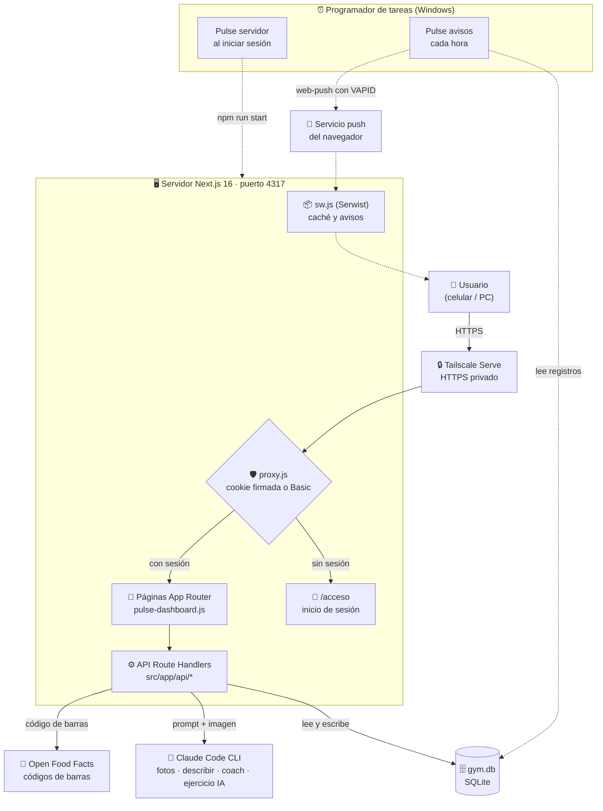
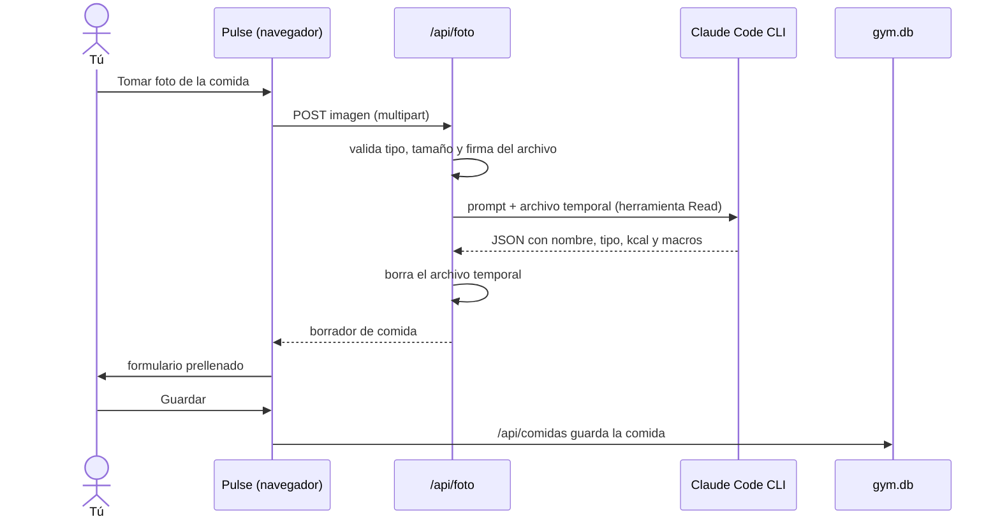
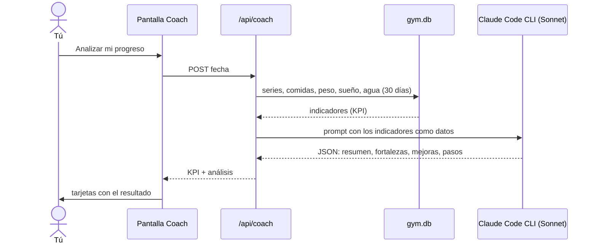
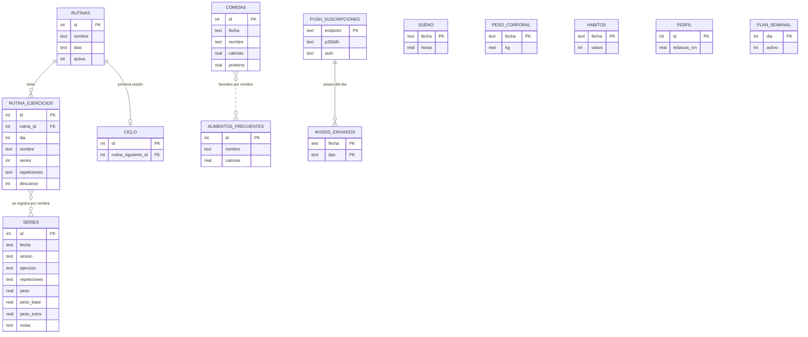
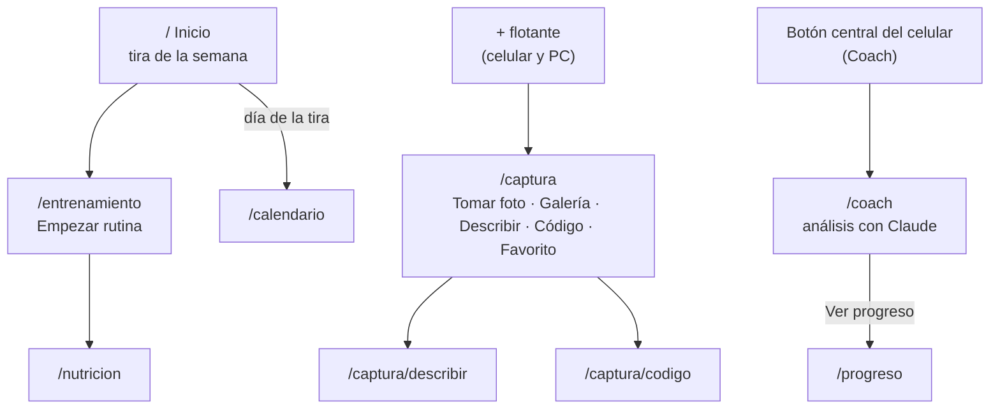
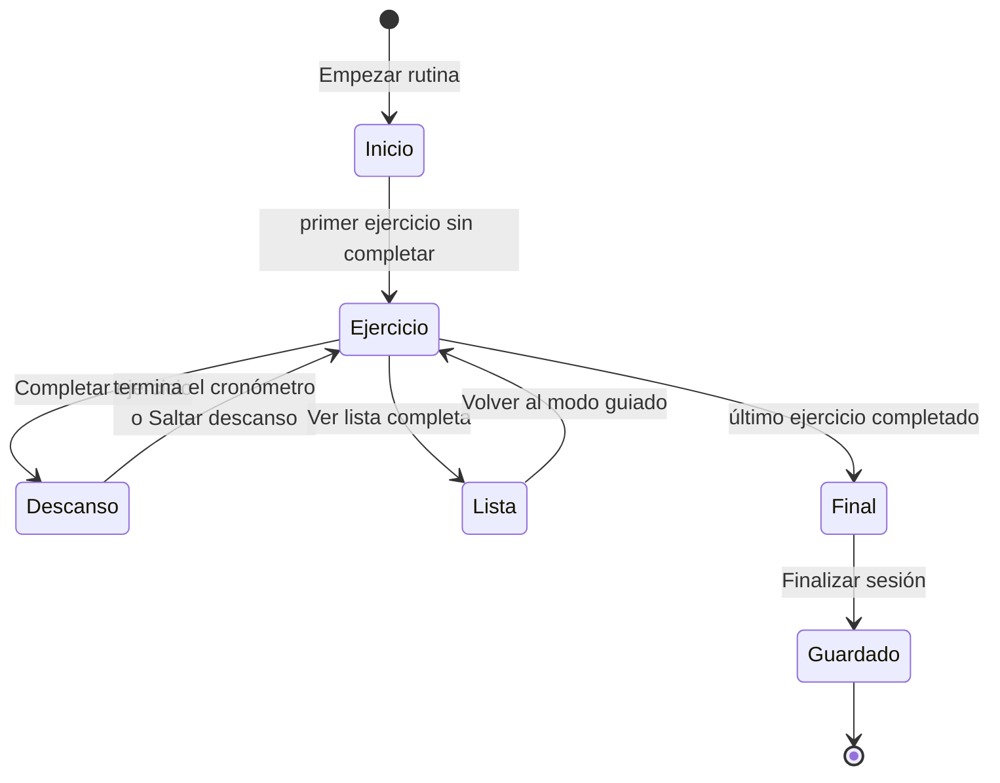

# Arquitectura de Pulse en diagramas

Esta página muestra cómo se conecta todo. Los diagramas se ven en GitHub y en cualquier visor de Markdown que soporte Mermaid.

## 1. Vista general

Pulse corre en tu PC como un solo servidor. El celular se conecta por Tailscale; la app instalada (PWA) usa el service worker para avisos.

## 2. Flujo de una foto de comida

Lo mismo sirve para **Describir con IA** y **Escanear código**, cambiando solo la ruta y la fuente de datos.

## 3. Flujo del Coach

## 4. Modelo de datos

## 5. Mapa de pantallas y rutas

La barra inferior del celular y la barra lateral del PC llevan a las pantallas principales. Captura de comida no tiene enlace en la barra: se abre con el botón **+**, que aparece en celular y en PC.

## 6. Sesión de entrenamiento (modo guiado)

## 7. Dónde vive cada cosa

| Pieza | Ruta en el proyecto |
| --- | --- |
| Pantallas y componentes | `src/app/`, `src/app/_components/pulse-dashboard.js`, `routine-builder.js`, `meal-form.js` |
| API | `src/app/api/*/route.js` |
| Acceso y sesión | `src/proxy.js`, `src/lib/sesion.js`, `src/app/acceso/` |
| Base de datos | `src/lib/db.js` (crea las tablas), archivo `gym.db` |
| Claude Code | `src/lib/comida-ia.js` (lanza el CLI) |
| Progresión de peso | `src/lib/progresion.js` |
| PWA y avisos | `src/app/sw.js`, `src/app/manifest.js`, `scripts/avisos.mjs` |
| Textos y reglas de validación | `src/lib/validacion.js`, `src/lib/plan.js`, `src/lib/exercise-library.js` |
