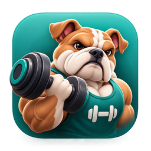
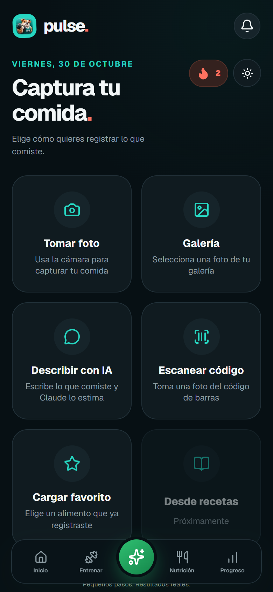
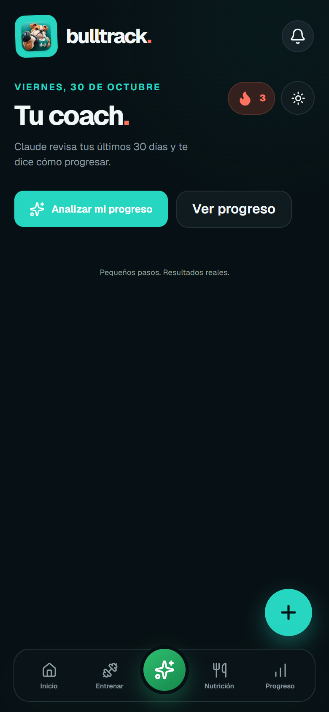
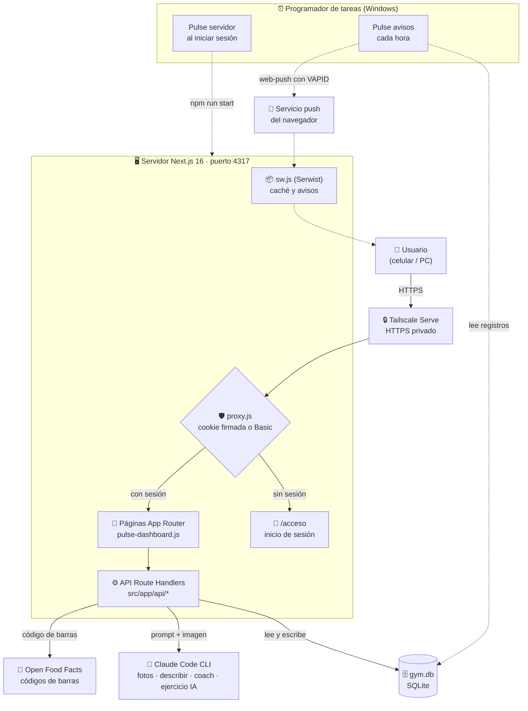

<div align="center">



# BullTrack

**Entrena, registra tu nutrición y mira tu progreso.**

Next.js · React · SQLite · PWA · Claude Code

</div>

BullTrack es una app personal para el gimnasio y la alimentación. Se usa desde la PC y el celular, y se puede instalar como app.

## Funciones

- **Entrenamiento:** rutinas por día de la semana, modo guiado con descanso por serie y registro de series, repeticiones y peso.
- **Nutrición:** comidas y macros, con estimación desde foto o descripción usando Claude Code.
- **Sueño, peso y agua:** registro diario, con variación de peso y horas dormidas calculadas.
- **Progreso:** gráficos de proteína, fuerza estimada por ejercicio y peso.
- **Coach y plan:** análisis de tus últimos 30 días con Claude, y un plan para ganar músculo con tus datos.
- **Avisos:** recordatorios y análisis de tu semana que llegan al celular.

## Capturas

| Inicio | Entrenamiento | Nutrición |
| --- | --- | --- |
|  |  |  |

| Coach | Nutrición | Progreso |
| --- | --- | --- |
|  |  |  |


## Arquitectura

Cómo se conectan las piezas. Más detalle en [ARQUITECTURA.md](ARQUITECTURA.md).



## Inicio rápido

1. Instala las dependencias: `npm install`.
2. Crea `.env.local` copiando `.env.example` y completa los valores.
3. Desarrollo: `npm run dev` y abre [http://localhost:3000](http://localhost:3000).
4. Producción (la que usa el celular): `npm run produccion`, en el puerto 4317.

## Acceso y configuración

- Pide usuario y contraseña en `/acceso`. La sesión dura 30 días.
- En `.env.local` van el usuario, la contraseña, el secreto de sesión y las claves VAPID (para los avisos). Si falta alguno, el servidor responde 503. No subas este archivo.
- `CLAUDE_CLI_PATH`: ruta al ejecutable de Claude Code, si la detección automática falla.
- `PULSE_ORIGEN_PUBLICO`: la dirección HTTPS de Tailscale, para usar la app desde el celular.

## Tailscale

Tailscale es una red privada entre tus dispositivos. Con **Tailscale Serve** la app queda accesible solo para tus equipos, con HTTPS, sin exponerla a internet.

Comandos útiles (PowerShell):

```powershell
& "C:\Program Files\Tailscale\tailscale.exe" status   # ver si PC y celular están conectados
& "C:\Program Files\Tailscale\tailscale.exe" down     # desconectar
& "C:\Program Files\Tailscale\tailscale.exe" up       # volver a conectar
```

Desde el celular abre `https://TU-PC.TU-RED.ts.net`.

## Tareas automáticas (Windows)

- **Pulse servidor:** arranca la app al iniciar sesión. Ejecuta `scripts/iniciar-pulse.ps1` y guarda su salida en `pulse-servidor.log`.
- **Pulse avisos:** cada hora ejecuta `scripts/avisos.mjs`, que envía los recordatorios y análisis push según tus registros. Guarda su salida en `avisos.log`. No usa IA ni gasta tokens.

Para probar los avisos sin enviarlos: `node scripts/avisos.mjs --simular`.

## Uso diario

- Después de cambiar código, vuelve a ejecutar `npm run produccion`. En producción los cambios no se ven hasta compilar de nuevo.
- Si cambias el puerto, actualízalo en `package.json`, en `scripts/iniciar-pulse.ps1` y en Tailscale Serve.

## Notas

- La estimación de comidas por foto usa Claude Code instalado en este equipo, con la cuenta de Windows que ejecuta el servidor. La imagen se envía al servicio de Anthropic para el análisis, y la copia local se borra al terminar.
- Depende de que el PC esté encendido. El análisis de una foto tarda entre 10 y 60 segundos.
