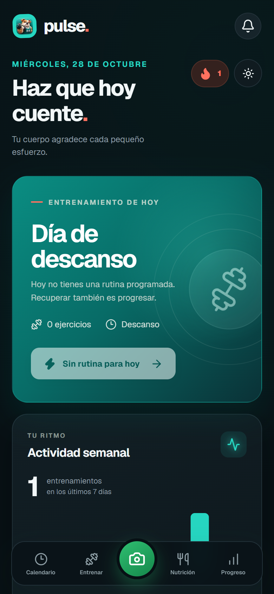
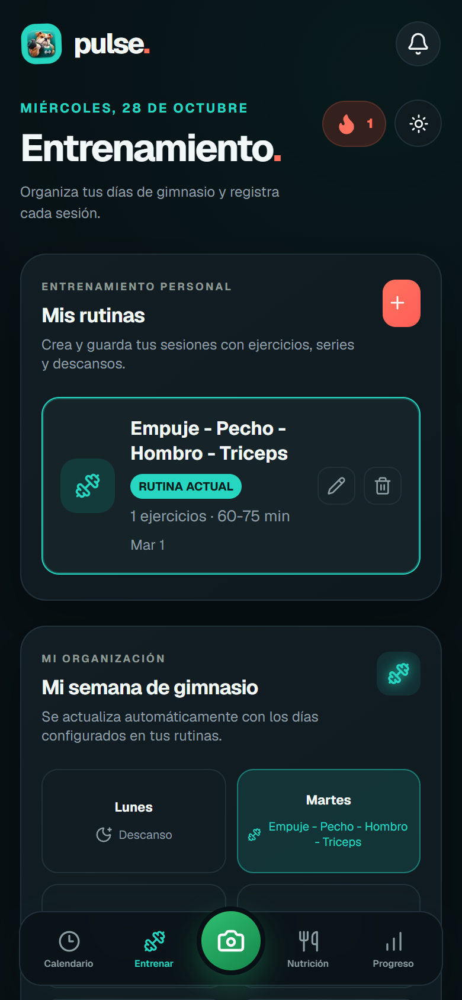
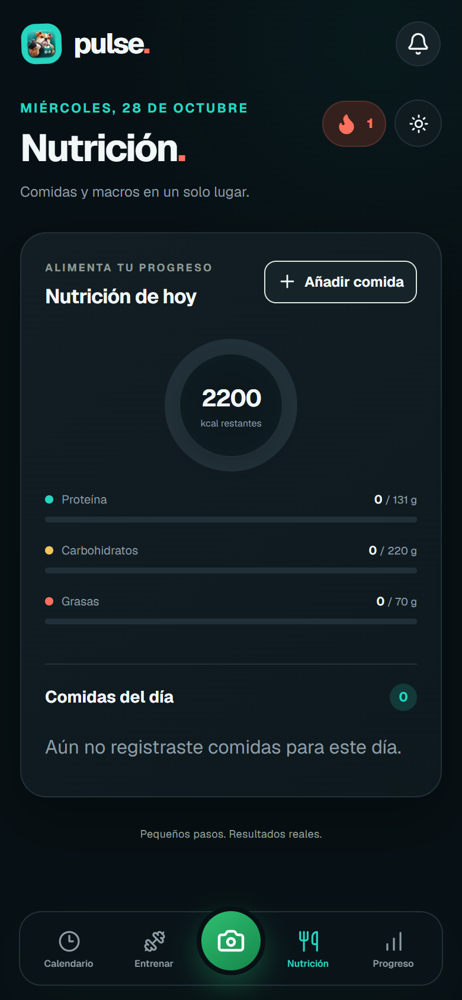
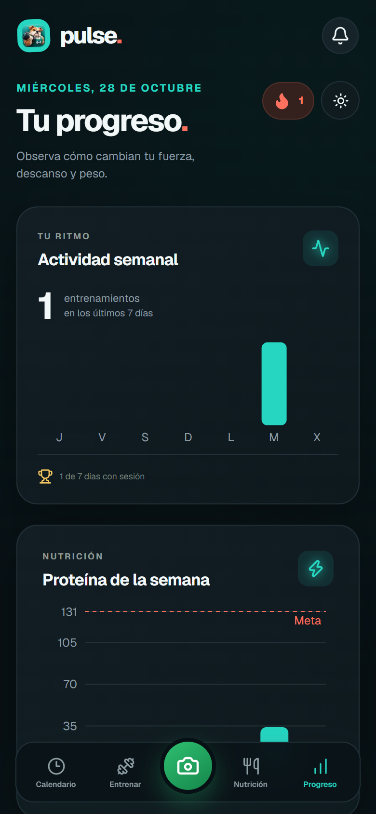
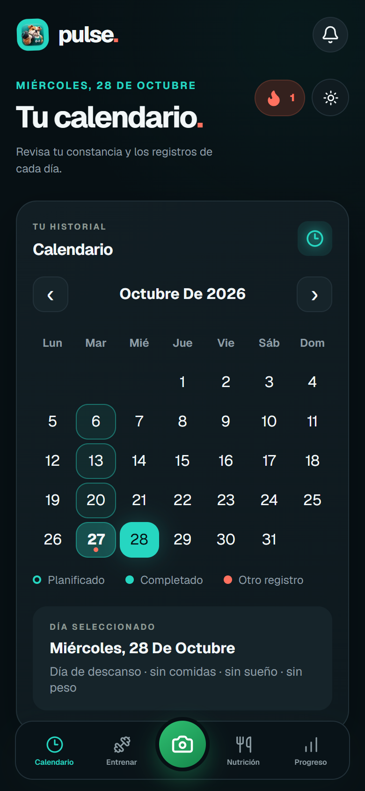
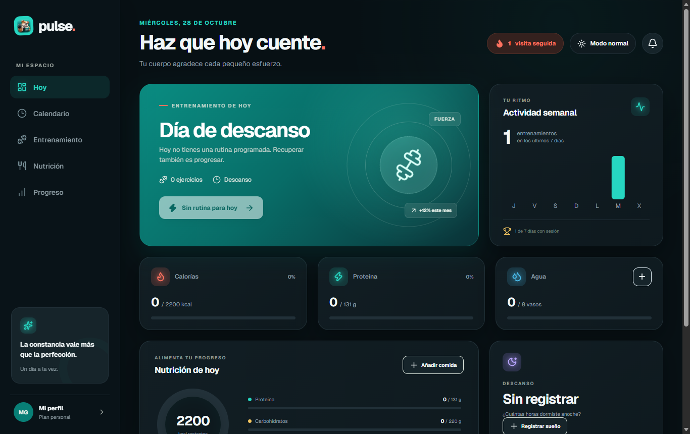

This is a [Next.js](https://nextjs.org) project bootstrapped with [`create-next-app`](https://github.com/vercel/next.js/tree/canary/packages/create-next-app).

## Getting Started

First, run the development server:

```bash
npm run dev
# or
yarn dev
# or
pnpm dev
# or
bun dev
```

Open [http://localhost:3000](http://localhost:3000) with your browser to see the result.

You can start editing the page by modifying `app/page.js`. The page auto-updates as you edit the file.

This project uses [`next/font`](https://nextjs.org/docs/app/building-your-application/optimizing/fonts) to automatically optimize and load [Geist](https://vercel.com/font), a new font family for Vercel.

## Learn More

To learn more about Next.js, take a look at the following resources:

- [Next.js Documentation](https://nextjs.org/docs) - learn about Next.js features and API.
- [Learn Next.js](https://nextjs.org/learn) - an interactive Next.js tutorial.

You can check out [the Next.js GitHub repository](https://github.com/vercel/next.js) - your feedback and contributions are welcome!

## Deploy on Vercel

The easiest way to deploy your Next.js app is to use the [Vercel Platform](https://vercel.com/new?utm_medium=default-template&filter=next.js&utm_source=create-next-app&utm_campaign=create-next-app-readme) from the creators of Next.js.

Check out our [Next.js deployment documentation](https://nextjs.org/docs/app/building-your-application/deploying) for more details.

## Seguridad de acceso

La app pide usuario y contraseña en un formulario de inicio de sesión (`/acceso`). Al entrar, el navegador guarda una cookie firmada que dura 30 días. Las rutas de API sin sesión responden 401.

Antes de iniciar el servidor, crea `.env.local` a partir de `.env.example` y completa todos los valores: usuario, contraseña, secreto de sesión y claves VAPID para las notificaciones. Si falta alguno de ellos, el servidor responde 503. No subas `.env.local` ni compartas sus valores.

Para acceder desde otro dispositivo, publica el servidor solo detrás de HTTPS y de una red privada de confianza (por ejemplo, Tailscale Serve). Las solicitudes de escritura desde navegadores también se limitan al mismo origen.

## PWA

La versión de producción incluye manifiesto instalable y service worker. Ejecuta `npm run build` y luego `npm run start`; durante `npm run dev` el service worker queda desactivado. Las rutas `/api/*` siempre van a la red y no se guardan en caché. Para instalar en un teléfono desde otro dispositivo, usa una conexión HTTPS de confianza.

La función de registro desde foto envía imágenes JPEG, PNG o WebP de hasta 8 MB al Claude CLI local. Requiere Claude Code actualizado (2.1.248 o posterior) y autenticado en la misma cuenta de Windows que ejecuta Next.js. En Windows, si la detección automática no encuentra la instalación global, configura `CLAUDE_CLI_ENTRY` en `.env.local` con la ruta completa al archivo `cli.js`. La estimación se revisa en el formulario antes de guardarse; el archivo temporal se elimina al terminar.

Nota de privacidad: Claude CLI se ejecuta en este equipo, pero envía la imagen al servicio de Anthropic para el análisis. No se guarda un historial de sesión y la copia temporal local se elimina al terminar.

## Comandos del servidor (uso diario)

Ejecútalos en PowerShell, dentro de la carpeta `mi-gym`.

Encender la app (compila y arranca en el puerto 3003, el que publica Tailscale):

```powershell
npm run produccion
```

Desconectar Tailscale (para probar que la app deja de cargar en el celular):

```powershell
& "C:\Program Files\Tailscale\tailscale.exe" down
```

Volver a conectar Tailscale:

```powershell
& "C:\Program Files\Tailscale\tailscale.exe" up
```

Ver el estado de Tailscale (PC y celular conectados):

```powershell
& "C:\Program Files\Tailscale\tailscale.exe" status
```

Dirección para abrir la app desde el celular:

```
https://TU-PC.TU-RED.ts.net
```

Si cambias código, vuelve a ejecutar `npm run produccion`: en producción los cambios no se ven hasta compilar de nuevo.

## Puerto y arranque automático

- **Puerto de producción: 4317** (antes 3003). Lo usa `npm run produccion` y lo publica Tailscale Serve. Si cambias el puerto, cámbialo en `package.json`, en `scripts/iniciar-pulse.ps1` y con `tailscale serve --bg http://localhost:NUEVO_PUERTO`.
- **Arranque al iniciar sesión**: el script `scripts/iniciar-pulse.ps1` ejecuta `npm run produccion` en segundo plano y guarda su salida en `pulse-servidor.log`. Para que se ejecute solo, regístralo en el Programador de tareas como tarea "Pulse servidor" con disparador "Al iniciar sesión" (ver los comandos de PowerShell abajo).

Crear la tarea (PowerShell, una sola vez):

```powershell
$accion = New-ScheduledTaskAction -Execute "powershell.exe" -Argument '-NoProfile -WindowStyle Hidden -ExecutionPolicy Bypass -File "C:\Users\Gamer\Desktop\Semestral\Proyectos_web\mi-gym\scripts\iniciar-pulse.ps1"'
$disparador = New-ScheduledTaskTrigger -AtLogOn
Register-ScheduledTask -TaskName "Pulse servidor" -Action $accion -Trigger $disparador -Description "Arranca Pulse (puerto 4317) al iniciar sesión." -Force
```

Iniciarla sin reiniciar el PC:

```powershell
Start-ScheduledTask -TaskName "Pulse servidor"
```

## Análisis de fotos de comida con Claude Code

La pantalla de Nutrición permite tomar una foto de una comida o elegirla de la galería. La app la envía al servidor, que usa Claude Code instalado en este equipo para estimar nombre, tipo de comida, kcal, proteína, carbohidratos y grasas. El resultado aparece en el formulario para que lo revises antes de guardarlo.

**Cómo está conectado**

1. El navegador envía la imagen a `POST /api/foto` (JPEG, PNG o WebP, hasta 8 MB).
2. La ruta valida el tipo real del archivo por sus bytes, lo guarda temporalmente en `uploads/` y lo borra al terminar.
3. Ejecuta el CLI de Claude Code con permisos mínimos: `--permission-mode plan`, `--tools Read` (solo lectura), `--max-turns 4` y `--restricted`. El directorio de trabajo es `uploads/`.
4. Lee la respuesta JSON, valida que los valores sean números finitos dentro de rango y devuelve la estimación al formulario.

**Configuración necesaria**

- Claude Code instalado y con sesión iniciada en la misma cuenta de Windows que ejecuta el servidor.
- En `.env.local`, `CLAUDE_CLI_PATH` con la ruta al ejecutable real (`...\@anthropic-ai\claude-code\bin\claude.exe`). Sin esta variable, la ruta puede tomar una carpeta de `node_modules\.bin` que no contiene el CLI.
- `PULSE_ORIGEN_PUBLICO` con la dirección HTTPS de Tailscale, para que el servidor acepte las peticiones que llegan desde el celular.

**Solución aplicada a los fallos encontrados**

- **Ruta del CLI incorrecta**: la búsqueda tomaba `node_modules\.bin` del `PATH` y no comprobaba que el archivo existiera. Se fijó `CLAUDE_CLI_PATH` al ejecutable real.
- **Sin resultado final**: con `--max-turns 1`, el modelo se detenía al pedir leer la imagen y nunca devolvía la estimación. Ahora son 4 turnos.
- **Error de origen (403) en HTTPS**: el navegador envía `Origin` con la dirección de Tailscale, pero el servidor solo aceptaba su host local. Se agregó `PULSE_ORIGEN_PUBLICO`.
- **Mensaje genérico "No se pudo completar la operación"**: aparecía cuando la respuesta no era JSON, como el 403 en texto plano. Así se identificó el origen del problema.
- **Campo de archivo solo con cámara**: se quitó el atributo `capture` para permitir cámara y galería.
- **Espera sin indicación**: mientras se analiza, aparece un aviso de carga que se quita al terminar.

**Idea de diseño**

La app no llama a la API de Anthropic directamente. Usa Claude Code de la misma PC, para que el análisis use la cuenta y los permisos del usuario y para no guardar claves de API en el proyecto. La imagen se envía al servicio de Anthropic para el análisis, y no se guarda historial de sesión.

**Limitaciones conocidas**

- Depende de que el PC esté encendido y con Claude Code autenticado.
- Si la imagen no es comida, el modelo puede devolver valores fuera de rango, y la app lo rechaza.
- Cada análisis tarda entre 10 y 60 segundos. Si la conexión se corta en ese tiempo, la petición falla.

## Capturas

Vista en celular:

| Inicio | Entrenamiento | Nutrición |
| --- | --- | --- |
|  |  |  |

| Progreso | Calendario |
| --- | --- |
|  |  |

Vista en escritorio:


